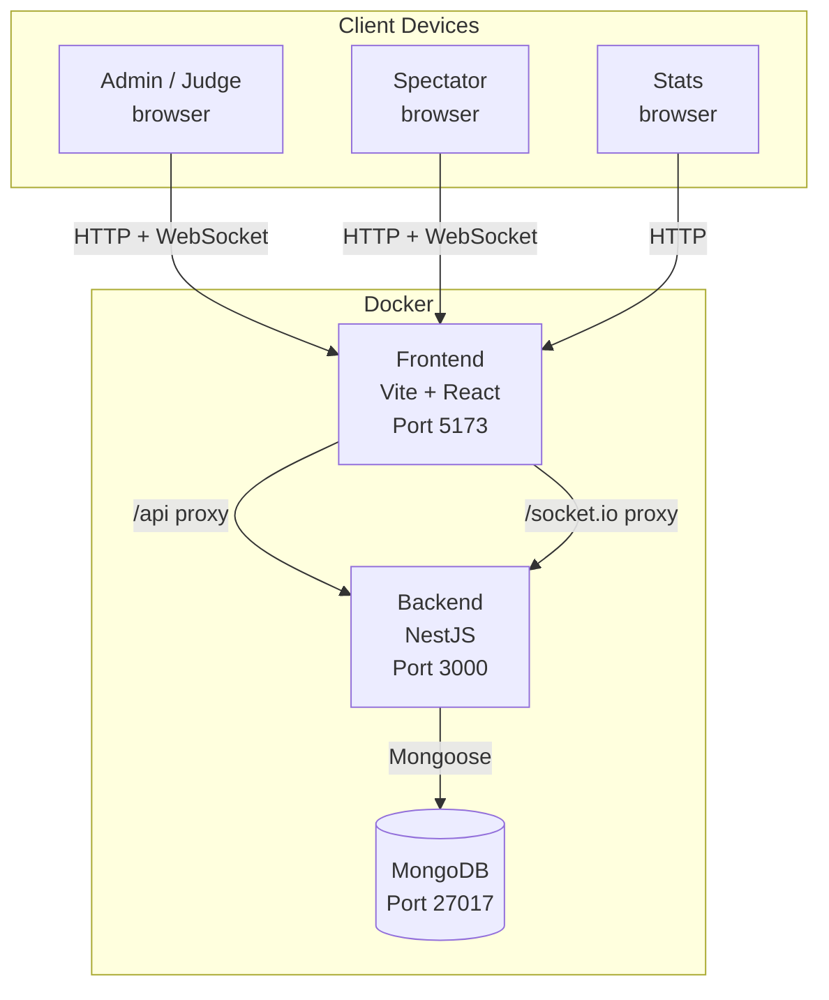
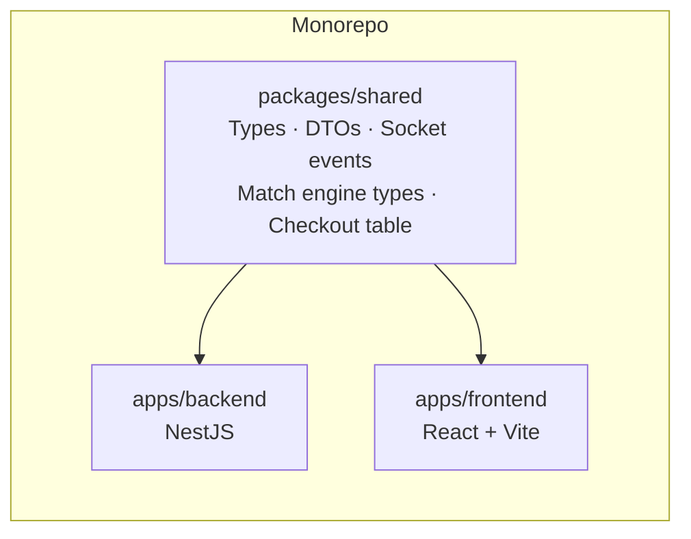
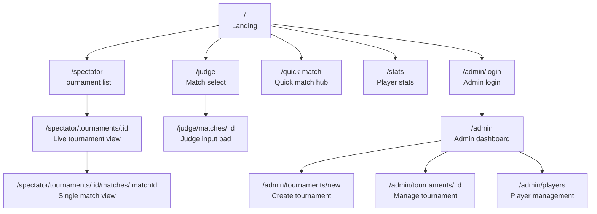
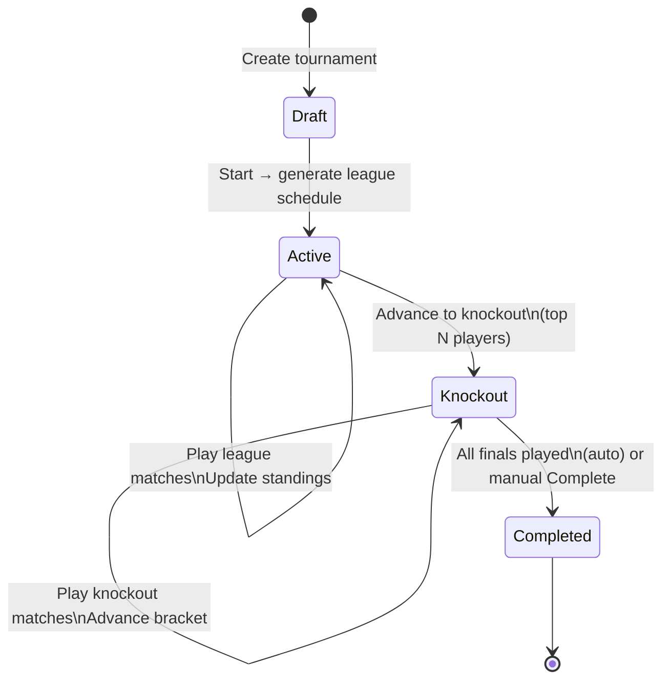
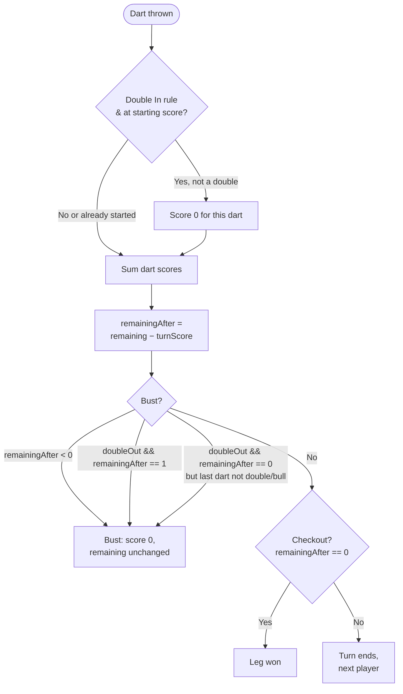
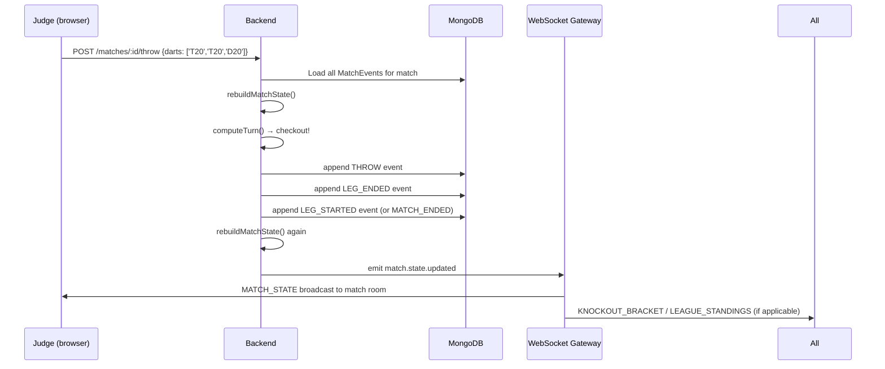
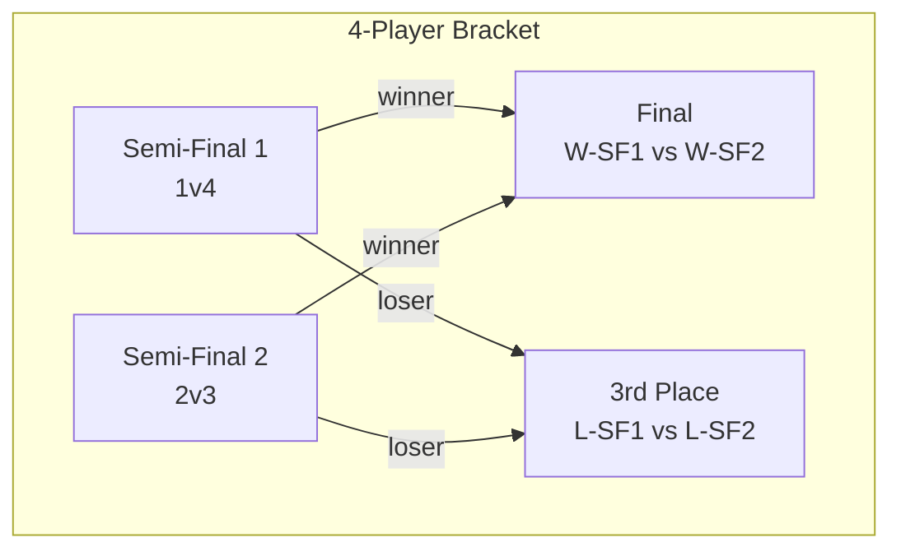
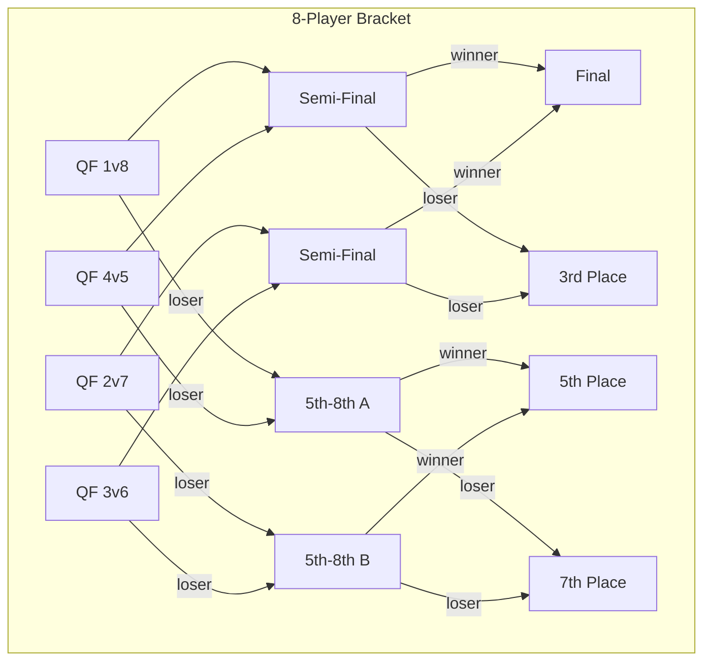
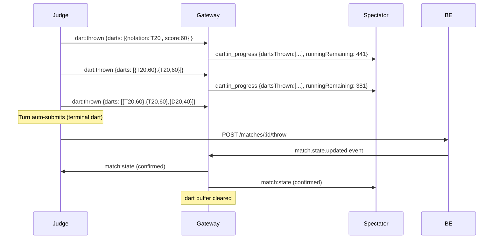
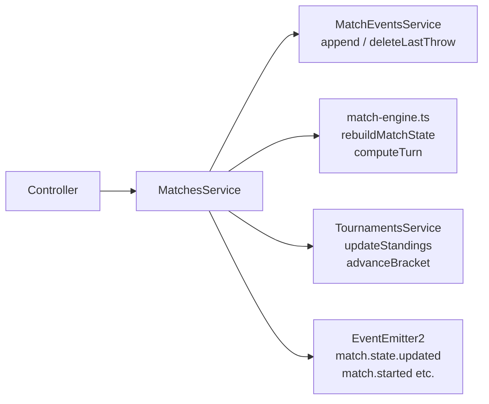

# Silcher Dart Scorer

A full-stack, real-time tournament management and live dart scoring system. Designed for use on a local network: one device runs the admin/judge interface, others spectate via any browser.

---

## Table of Contents

1. [Overview](#overview)
2. [Architecture](#architecture)
3. [Requirements](#requirements)
4. [Installation & Setup](#installation--setup)
5. [Configuration](#configuration)
6. [Running the App](#running-the-app)
7. [User Roles & Navigation](#user-roles--navigation)
8. [Tournament Lifecycle](#tournament-lifecycle)
9. [Match Engine](#match-engine)
10. [Data Structures](#data-structures)
11. [API Reference](#api-reference)
12. [WebSocket Events](#websocket-events)
13. [Services](#services)
14. [Frontend Stores](#frontend-stores)
15. [Backup & Restore](#backup--restore)
16. [Project Structure](#project-structure)

---

## Overview

Silcher Dart Scorer manages competitive darts tournaments end-to-end:

- **League phase** — Round-robin scheduler, configurable matches per player, live standings
- **Knockout phase** — Top 4 or 8 players advance; consolation bracket gives every player a second match
- **Live judging** — Mobile-friendly dart input pad; only one judge per match at a time
- **Spectator views** — Live scores, checkout hints, animated match cards
- **Stats** — Career averages, 180s, highest checkout, per-tournament history

All state is derived from an immutable event log — undo is always safe and nothing is lost.

---

## Architecture





---

## Requirements

| Tool | Version |
|------|---------|
| Docker | 24+ |
| Docker Compose | 2.20+ |
| Node.js (dev only) | 22+ |
| pnpm (dev only) | 9+ |

No other dependencies are needed to run via Docker.

---

## Installation & Setup

### 1 — Clone the repository

```bash
git clone <repo-url>
cd SilcherDartScorer
```

### 2 — Create environment file

```bash
cp .env.example .env   # or create .env manually (see Configuration)
```

### 3 — Build and start with Docker

```bash
docker compose up --build
```

First build takes ~2 minutes (installs all dependencies, compiles the shared package). Subsequent starts are fast.

| Service | URL |
|---------|-----|
| Frontend | http://localhost:5173 |
| Backend API | http://localhost:3000 |

To access from other devices on the same Wi-Fi network, replace `localhost` with the host machine's IP address (set `HOST_IP` in `.env`).

---

## Configuration

All configuration lives in `.env` at the project root.

| Variable | Default | Description |
|----------|---------|-------------|
| `MONGO_URI` | `mongodb://mongodb:27017/dart_tracker` | MongoDB connection string |
| `ADMIN_PIN` | `1234` | PIN required for the admin area and judge functions |
| `HOST_IP` | `192.168.178.33` | LAN IP shown as QR code on the spectator screen |

> **Security note**: `ADMIN_PIN` is sent as a Bearer token. Change this before using on any shared network.

---

## Running the App

### Production-like (Docker)

```bash
docker compose up
```

### Development (hot-reload)

```bash
# Terminal 1 — shared package (must build first)
cd packages/shared && pnpm build

# Terminal 2 — backend
cd apps/backend && pnpm start:dev

# Terminal 3 — frontend
cd apps/frontend && pnpm dev
```

### Run tests

```bash
# All backend tests
cd apps/backend && pnpm test

# Specific suite
cd apps/backend && pnpm test -- --testPathPatterns=league-scheduler
```

---

## User Roles & Navigation

The landing page (`/`) is the entry point for all roles.



### Role descriptions

| Role | Path | Description |
|------|------|-------------|
| **Spectator** | `/spectator` | Read-only live view of matches and standings |
| **Judge** | `/judge` | Input dart throws for a match; claims exclusive access |
| **Quick Match** | `/quick-match` | Instant match between any players, no tournament needed |
| **Stats** | `/stats` | Career and tournament statistics |
| **Admin** | `/admin` | Create/manage tournaments, players, backup/restore |

---

## Tournament Lifecycle



### Step-by-step

**1. Create tournament** (`/admin/tournaments/new`)
- Enter name, select players (minimum 4)
- Configure rules:
  - Starting score: 301, 501, or 701
  - Double In / Double Out toggles
  - Matches per player (e.g. 3 → each player plays ~3 league games)
  - League legs to win (e.g. 2 → first to 2 legs wins a match)
  - Knockout legs to win (e.g. 3 → best of 5 in knockout)
  - Number of boards (parallel matches)
  - Knockout size (top 4 or top 8 advance)

**2. Start tournament**
- Generates league schedule using the circle method
- Creates all match documents up front
- Initialises standings with zero values

**3. Play league matches**
- Admin starts each match (choosing who throws first)
- Judges enter throws via the judge pad
- Standings update live after each completed match
- Sorted by: Points → Leg difference → Legs won

**4. Advance to knockout**
- Available when all league matches are complete
- Top N players (by standing) seed into the bracket
- Knockout legs can be overridden at this point (e.g. change from 2 to 3 legs)
- Semi-finals created immediately; later rounds created automatically as matches complete

**5. Knockout play**
- Winners advance, losers drop to consolation bracket
- Bracket auto-advances when a match completes
- Placements (1st, 3rd, 5th, 7th) recorded automatically

**6. Complete**
- Triggered automatically when all bracket positions are decided
- Can also be triggered manually by admin

---

## Match Engine

All dart scoring logic lives in `packages/shared` and `apps/backend/src/core/match-engine`.

### Dart notation

| Notation | Score |
|----------|-------|
| `1`–`20` | Face value |
| `D1`–`D20` | Double (×2) |
| `T1`–`T20` | Triple (×3) |
| `25` | Outer bull |
| `BULL` | Bullseye (50) |
| `MISS` | 0 |

### Turn processing



### Event sourcing

Every action creates an immutable `MatchEvent` in the database. The current `MatchState` is always rebuilt by replaying events from sequence 1. This means:

- **Undo** = delete last throw event (and any system events after it) → replay remaining events
- **State recovery** = replay from DB at any point (e.g. after page refresh)
- **No data loss** = the full history is always preserved



### Checkout hints

`buildCheckoutDisplay(turnStartRemaining, thrownNotations, currentRemaining)` produces a visual checkout guide:

- Returns `null` if no valid finish exists (e.g. remaining > 170, or impossible score)
- Returns `[{notation, done}, ...]` for each dart in the optimal route
- If the player has already thrown some darts that match the route, those are marked `done: true`
- If the player deviates from the suggested route mid-turn, the display recalculates from `currentRemaining`

---

## Data Structures

### Player

```typescript
interface Player {
  _id: string
  name: string
  nickname?: string
  avatarColor: string        // hex, e.g. "#e74c3c"
  careerStats: {
    matchesPlayed: number
    matchesWon: number
    legsPlayed: number
    legsWon: number
    dartsThrown: number
    turnScoreTotal: number
    turnsPlayed: number
    checkoutAttempts: number
    checkoutHits: number
    oneEighties: number
    highestCheckout: number
    highestTurn: number
  }
  createdAt: string
}
```

### Tournament

```typescript
interface Tournament {
  _id: string
  name: string
  status: 'draft' | 'active' | 'completed'
  phase: 'league' | 'knockout'
  rules: TournamentRules
  players: string[]          // player IDs in seeding order
  leagueRounds: LeagueRound[]
  standings: LeagueStanding[]
  knockoutRounds: BracketRound[]
  placements: Record<string, number>  // playerId → 1st, 2nd, 3rd…
  createdAt: string
  startedAt?: string
  completedAt?: string
}

interface TournamentRules {
  startingScore: 301 | 501 | 701
  doubleIn: boolean
  doubleOut: boolean
  groupLegsToWin: number
  knockoutLegsToWin: number
  boardCount: number
  knockoutSize: 4 | 8
  matchesPerPlayer: number
}
```

### Match

```typescript
interface Match {
  _id: string
  tournamentId: string | null   // null for quick matches
  leagueRound: number | null    // 1–N for league, null for knockout
  roundNumber: number | null    // knockout round
  roundName: string | null      // 'Semi-Finals', 'Final', etc.
  slotIndex: number | null      // position in bracket slot array
  board: number | null          // physical board number
  status: 'pending' | 'active' | 'paused' | 'completed'
  players: string[]             // exactly 2 player IDs
  currentLegNumber: number
  legsWon: number[]             // [p1_legs, p2_legs]
  setsWon: number[]             // [p1_sets, p2_sets] (empty if legs-only)
  winnerId: string | null
  judgeId: string | null
  startedAt: string | null
  endedAt: string | null
  startingPlayerIndex: number
  isQuickMatch: boolean
  ruleStartingScore: number | null
  ruleDoubleIn: boolean | null
  ruleDoubleOut: boolean | null
  ruleLegsToWin: number | null
  ruleSetsToWin: number | null
}
```

### MatchEvent

```typescript
interface MatchEvent {
  _id: string
  matchId: string
  legNumber: number
  sequence: number             // monotonically increasing per match
  type: MatchEventType
  actorId: string              // judgeId or 'system'
  data: TurnData | { winnerId: string } | null
  timestamp: string
}

// Event types in order of a typical match:
// match_started → leg_started → throw → (bust | checkout) → leg_ended
// → leg_started → ... → match_ended
// Also: paused, resumed, undo
```

### MatchState (in-memory, never stored)

```typescript
interface MatchState {
  matchId: string
  status: 'active' | 'leg_complete' | 'match_complete'
  players: string[]
  currentLeg: LegState
  previousLegs: LegState[]
  legsWon: number[]
  legsWonInSet: number[]
  setsWon: number[]
  winnerId: string | null
  rules: MatchRules
}

interface LegState {
  legNumber: number
  remaining: number[]          // current score per player
  currentPlayerIndex: number
  startingPlayerIndex: number
  turns: TurnData[]
}
```

### Knockout bracket structure





---

## API Reference

All routes are prefixed with `/api` (via the Vite reverse proxy in development, or Nginx/direct in production).

### Auth

| Method | Path | Guard | Description |
|--------|------|-------|-------------|
| `GET` | `/auth/verify` | Admin | Verify PIN; returns `{ok: true}` |

### Players

| Method | Path | Guard | Body | Description |
|--------|------|-------|------|-------------|
| `GET` | `/players` | — | — | List all players |
| `GET` | `/players/:id` | — | — | Get single player |
| `POST` | `/players` | Admin | `{name, nickname?, avatarColor}` | Create player |
| `PATCH` | `/players/:id` | Admin | partial | Update player |
| `DELETE` | `/players/:id` | Admin | — | Delete player |

### Tournaments

| Method | Path | Guard | Body | Description |
|--------|------|-------|------|-------------|
| `GET` | `/tournaments` | — | — | List all tournaments |
| `GET` | `/tournaments/:id` | — | — | Get single tournament |
| `POST` | `/tournaments` | Admin | `CreateTournamentDto` | Create tournament |
| `POST` | `/tournaments/:id/start` | Admin | — | Start league phase |
| `POST` | `/tournaments/:id/advance-knockout` | Admin | `{knockoutLegsToWin?}` | Advance to knockout |
| `POST` | `/tournaments/:id/complete` | Admin | — | Mark completed |
| `DELETE` | `/tournaments/:id` | Admin | — | Delete tournament |

**CreateTournamentDto**

```jsonc
{
  "name": "Summer Cup",
  "playerIds": ["id1", "id2", "id3", "id4"],
  "rules": {
    "startingScore": 501,     // 301 | 501 | 701
    "doubleIn": false,
    "doubleOut": true,
    "matchesPerPlayer": 3,    // target league matches per player
    "groupLegsToWin": 2,      // legs to win a league match
    "knockoutLegsToWin": 3,   // legs to win a knockout match
    "boardCount": 2,          // parallel boards available
    "knockoutSize": 4         // 4 | 8 players advance
  }
}
```

### Matches

| Method | Path | Guard | Body | Description |
|--------|------|-------|------|-------------|
| `GET` | `/matches` | — | `?status&tournamentId&isQuickMatch` | Filter matches |
| `GET` | `/matches/quick/active` | — | — | Active quick matches |
| `POST` | `/matches/quick` | — | `{players, startingScore, doubleIn, doubleOut, legsToWin, setsToWin?}` | Create quick match |
| `DELETE` | `/matches/quick/:id` | — | — | Delete quick match |
| `GET` | `/matches/:id` | — | — | Get match document |
| `GET` | `/matches/:id/state` | — | — | Rebuild and return MatchState |
| `POST` | `/matches/:id/start` | — | `{startingPlayerIndex?: 0\|1}` | Start a pending match |
| `POST` | `/matches/:id/throw` | — | `{judgeId, darts[], ...rules}` | Submit a turn |
| `POST` | `/matches/:id/undo` | — | `{...rules}` | Undo last throw |
| `PATCH` | `/matches/:id/pause` | Admin | — | Pause match |
| `PATCH` | `/matches/:id/resume` | Admin | — | Resume match |

**Submit throw body**

```jsonc
{
  "judgeId": "judge-abc123",
  "darts": ["T20", "T20", "D20"],
  "startingScore": 501,
  "doubleIn": false,
  "doubleOut": true,
  "legsToWin": 2,
  "setsToWin": 0
}
```

### Stats

| Method | Path | Description |
|--------|------|-------------|
| `GET` | `/stats/player/:playerId` | Career stats + tournament history |
| `GET` | `/stats/tournament/:tournamentId` | Top performers for a tournament |

### Backup (Admin only)

| Method | Path | Description |
|--------|------|-------------|
| `GET` | `/admin/backup/export` | Export full database as JSON |
| `POST` | `/admin/backup/import` | Replace all data from JSON backup |
| `DELETE` | `/admin/backup/nuke` | Wipe all collections |

---

## WebSocket Events

The WebSocket gateway runs on the same port as the HTTP server (multiplexed by socket.io).

### Joining rooms (Client → Server)

| Event | Payload | Joins room |
|-------|---------|------------|
| `tournament:subscribe` | `tournamentId: string` | `tournament:{id}` |
| `match:subscribe` | `matchId: string` | `match:{id}` |
| `board:subscribe` | `board: number` | `board:{n}` |
| `judges:subscribe` | — | `judges:lobby` |

### Live dart entry (Client → Server)

| Event | Payload | Description |
|-------|---------|-------------|
| `dart:thrown` | `{matchId, darts: DartThrow[], playerId, remainingBefore}` | Broadcast current turn in progress to spectators |
| `judge:claim` | `{matchId, judgeId}` | Claim exclusive judging rights |
| `judge:release` | `{matchId}` | Release claim |

### State updates (Server → Client)

| Event | Room | Payload | Trigger |
|-------|------|---------|---------|
| `match:state` | `match:{id}` | `MatchState` | After every confirmed throw/undo |
| `match:started` | `tournament:{id}` + `judges:lobby` | `{matchId, tournamentId}` | Match starts |
| `match:ended` | `judges:lobby` | `{matchId, winnerId}` | Match completes |
| `match:reset` | `match:{id}` + `tournament:{id}` + `judges:lobby` | `{matchId}` | Match reset |
| `dart:in_progress` | `match:{id}` | `DartInProgressData` | Each dart typed (before confirmed) |
| `judge:claims_updated` | `judges:lobby` | `Record<matchId, judgeId>` | Claim/release |
| `tournament:standings` | `tournament:{id}` | `LeagueStanding[]` | League match completes |
| `tournament:phase_changed` | `tournament:{id}` | `{phase, knockoutRounds}` | Advance to knockout |
| `tournament:knockout_bracket` | `tournament:{id}` | `BracketRound[]` | Bracket updated |
| `tournament:updated` | `tournament:{id}` | `{tournamentId, status}` | Tournament completed |

### Live dart flow



---

## Services

### MatchesService

The central service. Coordinates event appending, state rebuilding, standings updates, and bracket advancement.



Key methods:

| Method | Description |
|--------|-------------|
| `submitThrow` | Validate → parse → compute → append events → check completion → advance bracket/standings → emit |
| `undo` | Delete last throw + system events → resync match doc → reverse bracket if needed → emit |
| `reset` | Delete all events → reinitialise match doc → update standings |
| `advanceKnockoutBracket` | Find next slot, seed winner/loser, create match doc, record placements, auto-complete tournament |
| `reverseKnockoutAdvancement` | Walk bracket backwards, clear slots, delete match docs, revert completion status |
| `updateStandings` | Aggregate all completed league match events → sort → save standings |

### LeagueScheduler

Uses the **circle method** (round-robin algorithm):

1. Fix the first player
2. Rotate the remaining players one position per round
3. Pair: fixed vs last, 2nd vs second-to-last, etc.
4. Repeat for `min(n-1, matchesPerPlayer)` rounds

Result: every player plays at most once per round, no pair meets twice within the schedule, and byes (for odd player counts) are distributed as evenly as possible.

Example — 4 players (A B C D), matchesPerPlayer=3:

| Round | Match 1 | Match 2 |
|-------|---------|---------|
| 1 | A vs D | B vs C |
| 2 | A vs C | D vs B |
| 3 | A vs B | C vs D |

For 12 players with `matchesPerPlayer=3`: 3 rounds × 6 simultaneous matches = **18 matches total** (each player plays exactly 3 games).

### KnockoutGenerator

Generates the full bracket skeleton upfront. All `TBD` slots are filled in by `advanceBracket` as matches complete.

Seeding (4-player example, ranked 1st–4th by standings):

| Match | Players | Purpose |
|-------|---------|---------|
| Semi-Final 1 | **1st vs 4th** | Protects top seed |
| Semi-Final 2 | **2nd vs 3rd** | |
| Final | W-SF1 vs W-SF2 | Placement 1st/2nd |
| 3rd Place | L-SF1 vs L-SF2 | Placement 3rd/4th |

### BackupService

Exports raw MongoDB documents (via `.lean()`) — all fields included as-is. Imports by wiping collections and reinserting raw JSON, converting string `_id` values to `ObjectId`. Schema validation is intentionally bypassed on import to preserve historical data that may predate schema changes.

Backups are forward-compatible: new fields added to schemas always have defaults (e.g. `matchesPerPlayer` defaults to `3` if absent from old backup data).

---

## Frontend Stores

All global state is managed with [Zustand](https://github.com/pmndrs/zustand).

| Store | State | Persistence |
|-------|-------|-------------|
| `auth.store` | `pin`, `isAdmin()` | localStorage |
| `players.store` | `players[]`, `getName(id)` | In-memory |
| `match.store` | `matchState`, `inProgress` | In-memory |
| `tournament.store` | `tournaments[]`, `activeTournament` | In-memory |

### usePlayers hook

Fetches the player list from the API on every component mount (no cache). This ensures newly added players always resolve to their name rather than showing raw IDs.

### useMatchSocket hook

Manages the full socket lifecycle for any screen that displays a live match:

1. Connects socket if not already connected
2. Fetches initial `MatchState` via HTTP (fallback only)
3. Subscribes to `match:{id}` (and optionally `tournament:{id}`) rooms
4. Listens to `MATCH_STATE` and `DART_IN_PROGRESS` → updates Zustand stores
5. HTTP result is discarded if a socket event arrives first (prevents stale overwrites)

---

## Backup & Restore

Accessible from `/admin` → Data section.

| Action | Description |
|--------|-------------|
| **Export** | Downloads `silcher-dart-backup-YYYY-MM-DD.json` containing all players, tournaments, matches, and match events |
| **Import** | Upload a backup file; replaces **all** current data (confirmation required) |
| **Nuke** | Wipes the entire database; requires typing `NUKE` to confirm |

---

## Project Structure

```
SilcherDartScorer/
├── docker-compose.yml
├── .env
├── packages/
│   └── shared/                      # compiled TypeScript library (@dart/shared)
│       └── src/
│           ├── types/
│           │   ├── enums.ts          # TournamentStatus, MatchStatus, MatchEventType, etc.
│           │   ├── player.types.ts   # Player, CareerStats
│           │   ├── tournament.types.ts # Tournament, TournamentRules, BracketRound, etc.
│           │   ├── match.types.ts    # Match, MatchEvent, TurnData, DartInProgressData
│           │   ├── match-engine.types.ts # MatchState, LegState, MatchRules
│           │   └── stats.types.ts    # PlayerStatsResponse, TournamentStatsResponse
│           ├── dto/
│           │   ├── create-tournament.dto.ts  # Zod schema + inferred type
│           │   ├── create-player.dto.ts
│           │   ├── submit-throw.dto.ts
│           │   └── admin-login.dto.ts
│           ├── socket-events.ts      # EVENTS constant, typed ClientToServer/ServerToClient
│           ├── checkout-table.ts     # CHECKOUTS map + buildCheckoutDisplay()
│           └── index.ts              # barrel export
└── apps/
    ├── backend/                     # NestJS application
    │   └── src/
    │       ├── main.ts
    │       ├── app.module.ts
    │       ├── config/env.config.ts
    │       ├── core/
    │       │   ├── match-engine/
    │       │   │   ├── dart-parser.ts        # notation → score, throws ParseError
    │       │   │   ├── match-engine.ts       # computeTurn, rebuildMatchState, applyTurnToLeg
    │       │   │   └── *.spec.ts
    │       │   └── scheduler/
    │       │       ├── league-scheduler.ts   # circle-method round-robin generator
    │       │       ├── knockout-generator.ts # bracket generator + advanceBracket
    │       │       └── *.spec.ts
    │       ├── gateway/
    │       │   └── tournament.gateway.ts     # socket.io gateway, all WS logic
    │       └── modules/
    │           ├── auth/            # AdminGuard (PIN check), /auth/verify
    │           ├── backup/          # export / import / nuke
    │           ├── match-events/    # MatchEvent CRUD, deleteLastThrow
    │           ├── matches/         # match lifecycle, throw/undo/reset, bracket logic
    │           ├── players/         # player CRUD
    │           ├── stats/           # career and tournament stats aggregation
    │           └── tournaments/     # tournament lifecycle, standings, knockout advance
    └── frontend/                   # React + Vite application
        └── src/
            ├── api/client.ts        # Axios with /api base, auto-auth header, 401 redirect
            ├── components/ui/       # BackButton
            ├── hooks/usePlayers.ts  # always-fresh player list
            ├── socket/
            │   ├── socket.client.ts # typed socket.io-client instance
            │   └── useMatchSocket.ts # lifecycle hook for live match screens
            ├── stores/              # Zustand: auth, players, match, tournament
            └── routes/
                ├── Landing.tsx
                ├── admin/           # Login, Dashboard, TournamentNew/Manage, PlayerList
                ├── judge/           # MatchSelect, JudgeMatch (dart input pad)
                ├── quick-match/     # QuickMatchHub, QuickMatchSetup
                ├── spectator/       # TournamentList, TournamentView, SpectatorMatch
                └── stats/           # PlayerStatsList, PlayerStatsPage, TournamentStatsPage
```
